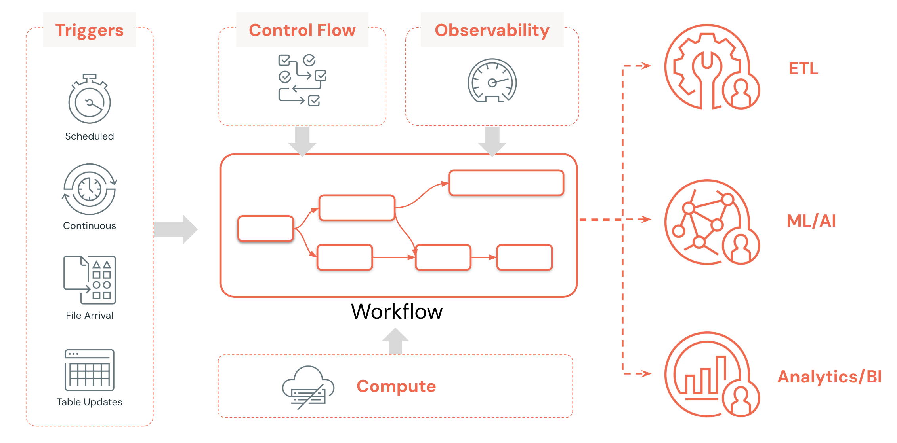
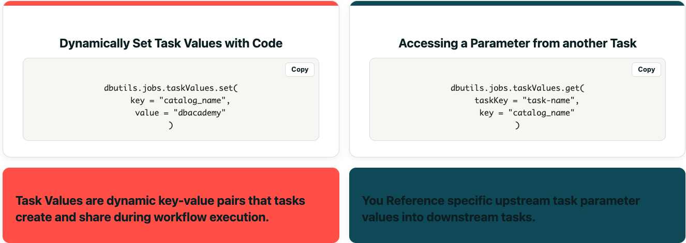
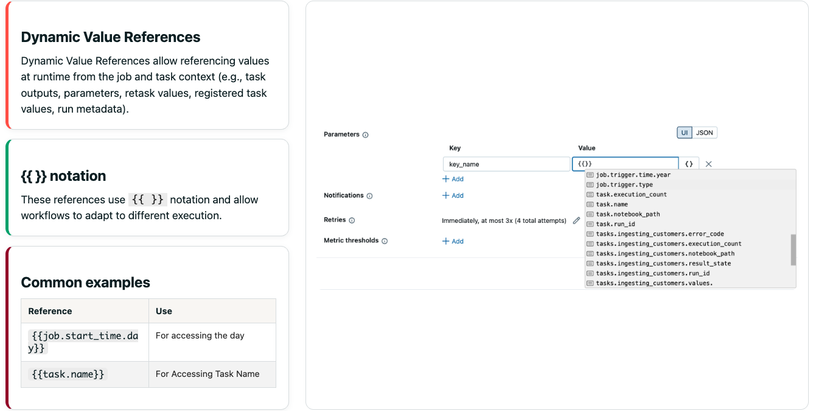
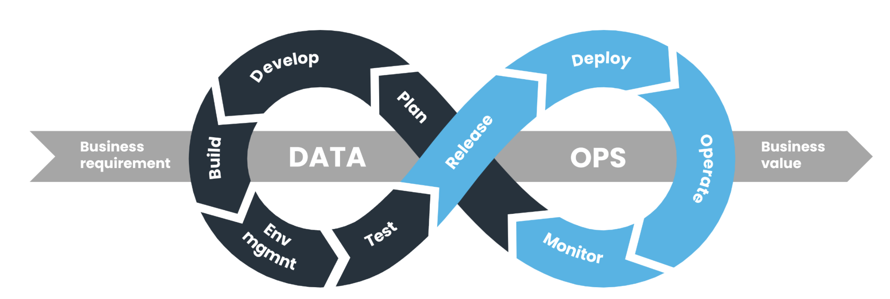
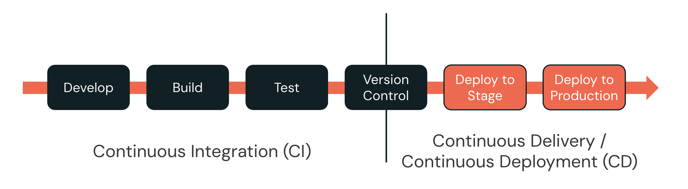

# databricks-learning

# Notes

#### Databricks Lakeflow

Lakeflow provides a unified platform for data ingestion, transformation, and orchestration, and includes the following components:

- **Lakeflow Connect**: A set of efficient ingestion connectors that simplify data ingestion from popular enterprise applications, databases, cloud storage, message buses, and local files.
- **Spark Declarative Pipelines**: A framework for building batch and streaming data pipelines using SQL and Python, designed to accelerate ETL development.
- **Lakeflow Jobs**: A workflow automation tool for Databricks that orchestrates data processing tasks and workflows. It enables coordination of multiple tasks within complex workflows, allowing for the scheduling, optimization, and management of repeatable processes.

---

#### Data Ingestion with Lakeflow Connect

1. **LakeFlow Connect** is the ingestion layer within the Databricks Data Intelligence Platform that replaces the traditional patchwork of ingestion tools with a unified, managed solution.
2. LakeFlow Connect provides three types of connectors: **Upload Files**, **Standard Connectors**, and **Managed Connectors**, each designed for different data source types.
3. Three ingestion methods are available: **Batch** (processes all records), **Incremental Batch** (processes only new records), and **Streaming** (continuous, near real-time ingestion).
4. **Delta Lake** is an open-source protocol that stores data as Parquet files with transaction logs, enabling ACID transactions, time travel, DML support, and schema enforcement.
5. The **Medallion Architecture** (Bronze, Silver, Gold) progressively improves data quality as it moves through each layer.

---

| **FEATURE** | **CREATE TABLE AS (CTAS) + spark.read** | **COPY INTO** | **Auto Loader** |
| --- | --- | --- | --- |
| **Ingestion Type** | Batch | Incremental Batch | Incremental (Batch or Streaming) |
| **Use Cases** | Best for smaller datasets | Ideal for thousands of files | Scale to millions+ of files per hour, backfills with billions of files |
| **Syntax/Interface** | • Python (spark.read)
• SQL (CTAS) | SQL | • Python (spark.readStream)
• SQL with Declarative Pipelines (CREATE OR REFRESH STREAMING TABLES)
• Streaming tables in Databricks SQL |
| **Idempotency** | No | Yes | Yes |
| **Schema Evolution** | Manual or inferred during read | Supported with options | Auto Loader automatically detects and evolves schemas. Handles new columns as they appear. |
| **Latency** | High | Moderate (scheduled) | Low or high depending on configuration |
| **Ease of Use** | Simple | Simple and SQL-based | Intermediate to advanced depending on the implementation |
| **Summary** | Best for one-time, ad hoc ingestion. Can be scheduled to always read and process all data. | Simple and repeatable for incremental file ingestion. Great for scheduled jobs or pipelines. | Best for near real-time streaming or incremental ingestion, with high automation and scalability. |

CTAS

Batch ingestion using `read_files()` that creates Delta tables from raw files. Best for smaller, ad hoc datasets.

```sql
CREATE TABLE new_table AS
          SELECT *
          FROM read_files(
            <path_to_file(s)>,
            format => '<file_type>',
            <other_format_specific_options>
          );
```

**`CREATE TABLE AS (CTAS)`** creates a Delta table **by default** from files in cloud object storage.

The **`read_files()`** function reads files under a provided location and returns the data in **tabular form.**

COPY INTO

Incremental batch ingestion that is idempotent and retriable. Skips already-loaded files and supports format and copy options for fine-grained control.

- **Describe how schema mismatches are handled** (mergeSchema: true) |  {injecting metadata cols, rescued_data ingestion}

```sql
CREATE TABLE new_table;

        COPY INTO new_table
        FROM '<dir_path>'
        FILEFORMAT = <file_type>
        FORMAT_OPTIONS (<options>)
        COPY_OPTIONS (<options>)
```

Use the **`COPY INTO`** statement to copy files from cloud storage into the Delta table; this performs a bulk load from files in cloud object storage into the table.

The **`COPY INTO`** will skip any files that have already been loaded into the table, and only new files will be ingested.

AUTO LOADER

The most scalable method, built on Spark Structured Streaming. Supports both Python and SQL (via Declarative Pipelines), processes billions of files, and automatically handles schema evolution.

**Python Auto Loader**

(spark.readStream    .format("cloudFiles")    .option("cloudFiles.format", "json")    .option("cloudFiles.schemaLocation", "<`checkpoint_path`>")    .load("/Volumes/catalog/schema/files")  .writeStream    .option("checkpointLocation", "<`checkpoint_path`>")    .trigger(processingTime="5 seconds")    .toTable("catalog.database.table"))

**Auto Loader with SQL (Declarative Pipelines)**

CREATE OR REFRESH STREAMING TABLE  catalog.schema.tableSCHEDULE EVERY 1 HOURASSELECT *FROM STREAM read_files(  '<`dir_path`>',  format => '<`file_type`>')
		

---

rescued_column, schema handling

---

Loading Json 

---

Data Ingestion using Lakeflow Managed Connected

Databricks provides additional features such as Lakehouse Federation, Zerobus, Delta Sharing, and Databricks Marketplace to expand data integration, sharing, and collaboration capabilities in the Lakehouse

Lakehouse Federation: Allows you to query external data sources without moving your data.

Especially useful for:

- **Ad hoc reporting**
- **Proof-of-concept** work
- The **exploratory phase** of new ETL pipelines or reports
- Supporting workloads during **incremental migration**

---

**Zerobus *(coming soon)***: A **LakeFlow Connect API** that allows developers to **write event data directly to their lakehouse** at very high throughput (100 MB/s) with near real-time latency (<5 seconds).
**Simplify ingestion** for:IOT, Clickstreams, Telemetry, and more

Delta Sharing: Allows you to **securely share data** across platforms, clouds, and regions.

---
#### Deploy workloads with Lakeflow Jobs

**Lakeflow Jobs** allows you to orchestrate every type of workload within Databricks, including notebooks, SQL queries, dashboards, pipelines, and much more.



**Building blocks of Lakeflow Jobs:**

1. **Jobs**  - Worflow, consists of one or more tasks **[ Notebooks, Delta Live tables, SQL Files/Queries, Python Scripts/Wheels, dbt, Java Jar File. etc]**
    
    At Job level we can define
    
    1. Job details (Performance optimized - **on/off** for savings costs)
    2. Schedules / triggers (**Manual triggers** for on-demand execution, **Scheduled triggers** using cron expressions, **API triggers** for programmatic execution, **File Arrival** triggers for event-driven processing, **Table triggers** for data change events, and **Continuous triggers** for streaming workloads)
    3. Job Parameters (key/value pairs)
    4. Tags, Git Integration
    5. Job Notifications (Email, Slack, Teams, Webhook - by using URL + Authentication (OAuth and Basic Auth))
2. **Tasks** - A task is a single unit of work within a job that executes a specific workload such as a notebook, script, query, and more
    1. Task name
    2. Source (Workspace / Git-Provider)
    3. Path (Notebook/Script Path)
    4. Compute (Task-1 running on an All Purpose Cluster, Task-2 on Serverless, Task-3 on a Job Cluster, and so on. This flexibility allows you to optimize both performance and cost for each specific task)
    5. Environment Variables
    6. Parameters Notifications (Start / Success / Failure) & Retries (Unlimited with retry delay)

**Languages Supported:** Python, Scala, Java, R, SQL

**Conditional Task Dependencies:** Sequential, Parallel, For-Each, If-Else etc

---

**Project**


**Job & Task Parameters**

1. Setting and Accessing Parameters (UI)


1. Dynamically Set Task Values with Code



1. Dynamic Value References



---

**System Tables**

```sql
SHOW SCHEMAS IN system;

SHOW TABLES IN system.lakeflow;

%sql
SELECT jobs.workspace_id,
       jobs.name as job_name,
       jobs.job_id,
       timeline.run_id,
       timeline.period_start_time,
       timeline.period_end_time,
       timeline.task_key,
       timeline.result_state
FROM system.lakeflow.jobs as jobs
INNER JOIN
system.lakeflow.job_task_run_timeline as timeline
ON jobs.job_id = timeline.job_id
WHERE lower(jobs.name) LIKE 'retail_sales_%'
ORDER BY timeline.period_start_time
```

**Common Best Practices**

**Compute**

- **Interactive Clusters**
    - development and ad-hoc analysis
    - Cost Issues: Runs even when not executing jobs
    - Limited Scalability
    - Availability Concerns: Multiple users sharing clusters can cause resource conflicts and job delays
- **Job Clusters** - production use
    - Cost Efficiency: Clusters terminate when jobs complete
    - Dedicated Resources: Each job gets dedicated compute resources
    - No Maintenance Overhead and Startup Latency
- **Serverless compute** - the optimal choice for most production workloads because it provides operational simplicity, performance optimization, reliability and speed, and cloud independence.

**Modular Design**

- Break complex DAGs into logical business units rather than technical components.
- Each module should represent a cohesive business function that can be developed, tested, and deployed independently.

**Git Integration**

- Prevents unintentional changes to production jobs
- **Single Source of Truth:** Eliminates confusion about which version of code is running in production by always executing from committed code in specific branches or tags.
- **CI/CD Integration:** Enables automated testing and deployment pipelines that can validate changes before they reach production environments.
- **Platform Support** - Most Providers Github, Gitlab etc provides support
- **Collaboration Benefits:** Multiple developers can collaborate on workflow development using standard Git workflows (branches, pull requests, code reviews) while maintaining production stability.

---
#### Build Data Pipelines with Apache Spark Declarative Pipelines

With Spark Declarative Pipelines, you can focus your ETL efforts by ingesting data using either batch or streaming method.

1. **Batch ingestion** is designed for large volumes of data that arrive all at once.
2. **Streaming ingestion**, on the other hand, handles data that flows continuously in small increments, enabling near real-time processing.

Once your data is ingested, you’ll follow the medallion architecture to organize and refine it:

- **Bronze** is the raw data ingestion layer in your lakehouse. Here, data is brought in as-is, sometimes with additional metadata columns added to provide context about the ingestion process.
- **Silver** is where cleaning and transformation happen, turning raw data into a more usable and refined table.
- **Gold** represents the final business-level aggregates designed for downstream use cases such as reporting, machine learning, AI, streaming analytics, and more.

This structured approach helps ensure data quality and usability across your organization’s analytics and operational needs. Spark Declarative Pipelines make this entire process easy to create, monitor, and optimize, so you can focus on driving insights rather than managing complexity.

Data Quality Rules in SDP

1. **Expectations are data quality rules** defined using the `CONSTRAINT ... EXPECT (...)` syntax directly within your pipeline SQL — validating data row-by-row during ETL.
2. **WARN** (the default action) logs violations and still writes invalid rows to the target — ideal for non-critical quality monitoring without interrupting the pipeline.
3. **DROP** removes invalid rows from the output and logs the count — suitable for cases where bad data must be excluded but the pipeline should continue running.
4. **FAIL** stops the specific flow when a violation occurs and requires manual intervention — used for critical data issues that must be resolved before downstream processing.
5. **Multiple constraints** can coexist in a single table definition, each evaluated independently — giving you layered, granular control over data quality across all columns.

```jsx
CREATE OR REFRESH STREAMING TABLE 2_silver_db.orders_silver
 (
   CONSTRAINT valid_notifications EXPECT (notifications IN ('Y','N')),
   CONSTRAINT valid_date EXPECT (order_timestamp > "2021-01-01") ON VIOLATION FAIL UPDATE,
   CONSTRAINT valid_id EXPECT (customer_id IS NOT NULL) ON VIOLATION DROP ROW
 )
AS
SELECT
  order_id,
  timestamp(order_timestamp) AS order_timestamp,
  customer_id,
  notifications
FROM STREAM 1_bronze_db.orders_bronze;
```

---

#### DevOps Essentials for Data Engineering

1. **Maintain Modularized Code**
    
2. **DevOps Fundamentals**
    
    - The DevOps lifecycle is all about seamless collaboration between development and operations teams to deliver high-quality software
    
    **Data Ops:** DataOps is a subset of DevOps and applies DevOps to data engineering. It automates the management of data pipelines, ensuring smooth, reliable data flows from collection to processing. This means fewer bottlenecks and faster insights.
    
    
    
3. **The Role of CI & CD**
    
    CI/CD process streamlines development of your data pipelines by automating testing and deployment, leading to faster, more reliable releases
    
    
    
    **Testing Steps:**
    
    - System Tests: Test the entire application, ensuring that all parts function together in a real-world scenario.
    - Integration Tests: Test the interaction between different components or systems. Ex: Notebooks / SDP/ Jobs interactions
    - Unit Tests: Test individual functions or methods in isolation. Fast, low cost, high coverage, and automated. Ex: Custom pyspark functions